# Build It

Design, build, and internally review a known task without a separate research
report or prepared plan. This replaces Implementation Harness, whose entry point
required both.

```mermaid
flowchart LR
    Task[Task + available context] --> Design[Visual architecture Canvas]
    Design --> Attack[Independent architecture challenge]
    Attack -->|bounded revision| Design
    Attack --> Approval[User architecture approval]
    Approval -->|feedback| Design
    Approval -->|approved| Build[Code / architecture-document implementation]
    Build --> Verify[Meaningful verification]
    Verify --> Review[Independent internal review]
    Review -->|changes required, max 3 cycles| Build
    Review -->|passed or cycle limit| ResultApproval[User implementation approval]
    ResultApproval -->|feedback| Build
    ResultApproval -->|approved| Done[Done]
```

The architect inspects only the code/docs needed to design the slice. Broad
analogue research, a research artifact and a second execution plan are absent.
Missing product/API choices or critical facts use a focused non-blocking stop;
missing optional prior research or a plan does not prevent entry.

The single `reasons-canvas-architecture` Markdown artifact uses the shared
visual REASONS format: plain-language titles, Mermaid behavior/state/collaboration
views, an annotated ASCII source-change tree and a dependency/outcome graph.
No tables, copied dossiers, duplicated proof inventories or HTML-export phase.
Exact contracts, compatibility, source evidence, ownership, verification and
rollback remain explicit. Caller presentation replaces the role's default
heading order without removing its proof obligations.

Separate author/reviewer agents challenge the design with at most two attack
passes. At the loop limit, unresolved findings stay visible at the user gate;
reaching the gate is not a pass. User rejection returns to the author and then
to the same approval gate. Only explicit approval unlocks implementation.

The approved Canvas supplies disjoint backend/frontend/architect owner zones and
the initial reviewer fanout. Parallel implementation branches work independently
from that Canvas and repository state. Workers fix in-scope failed checks;
contradictions or required redesign stop for resolution.

Independent reviewers inspect the completed implementation read-only. Actionable
findings are grouped by implementation owner and return only the affected branches
to implementation, followed by the required re-review fanout. The loop is bounded
at three review cycles. A clean review or the loop limit reaches the user
implementation gate; the limit preserves unresolved findings and is never treated
as a pass. User-requested rework returns directly to that same gate without an
unannounced fourth review cycle.

Build It does not publish, commit, push or release. Use SPDD when broad discovery
or the full research/design process is required.
